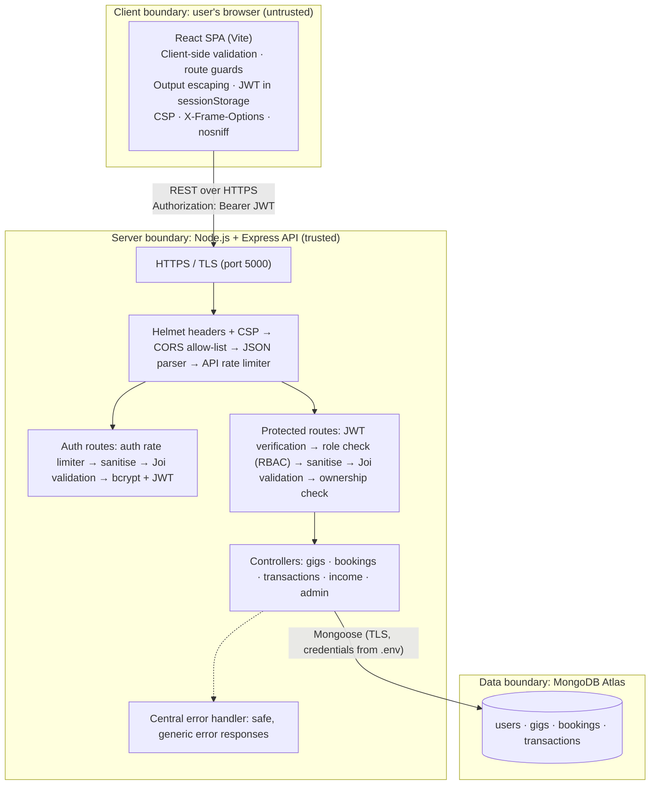
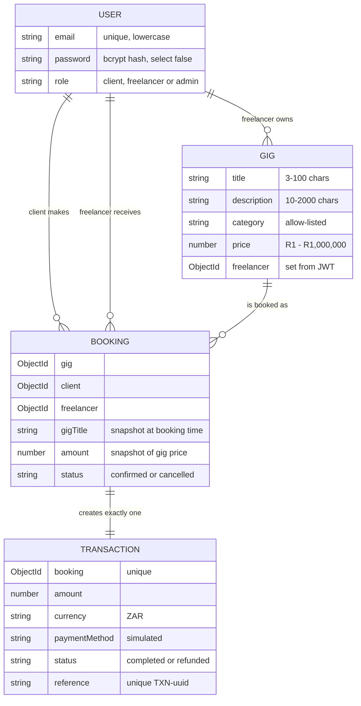

# HustleHub+ — Secure Freelance Marketplace

HustleHub+ is a secure MERN freelance marketplace. Freelancers advertise services ("gigs"), clients browse and book them, every booking produces a transaction record, and freelancers can see the income those bookings generate.

| Deliverable | Link |
| --- | --- |
| Part 1 demonstration video | https://youtu.be/EAS0zCbsnIk |
| Part 2 demonstration video | https://youtu.be/QLtFmcK9Nzs |

---

## Contents

1. [System overview](#1-system-overview)
2. [Intended users and features](#2-intended-users-and-features)
3. [System architecture](#3-system-architecture)
4. [Technology stack](#4-technology-stack)
5. [Project structure](#5-project-structure)
6. [Data model](#6-data-model)
7. [API reference](#7-api-reference)
8. [Security implementation](#8-security-implementation)
9. [Security review: threats and protections](#9-security-review-threats-and-protections)
10. [Running the application](#10-running-the-application)
11. [Testing](#11-testing)
12. [Evidence](#12-evidence)
13. [Known limitations and planned work](#13-known-limitations-and-planned-work)
14. [Team and contributions](#14-team-and-contributions)
15. [Reference list](#reference-list)

---

## 1. System overview

HustleHub+ processes user credentials, bookings, financial transactions and income data, so security was designed in from the start rather than added afterwards. The backend API is the security boundary: the React frontend never talks to the database, and every request that reads or changes data is authenticated, authorised, sanitised and validated by the backend first.

**What changed in Part 2.** Part 1 delivered a secure backend for registration and login with in-memory storage. Part 2 extends it into a full-stack application:

* MongoDB persistence (via Mongoose) replaces the in-memory user store.
* Gig management, bookings, simulated payments with transaction records, and income tracking.
* A React frontend for clients and freelancers.
* Role-based access control for clients, freelancers and administrators, including resource-ownership checks.
* Input sanitisation, rate limiting, Helmet security headers and a Content Security Policy.
* Automated testing: Postman collections run with Newman, and frontend tests with Vitest and React Testing Library.

---

## 2. Intended users and features

| Role | How the account is created | What the role can do |
| --- | --- | --- |
| **Client** | Public registration | Browse and search gigs; view gig details; book a gig with a simulated payment; view their bookings and transactions |
| **Freelancer** | Public registration | Create, edit and delete their own gigs; view bookings they have received; view their income dashboard (total income, this month, bookings, average per booking, monthly breakdown) |
| **Admin** | Seed script only (`npm run seed:admin`); never through public registration | List all users (without password hashes); remove any gig for moderation; view all bookings and transactions |

**Booking flow.** A client opens a gig, clicks *Book this gig*, confirms the simulated payment, and receives a booking confirmation with a transaction reference (for example `TXN-3f2a…`). No real payment is taken. Each booking creates exactly one transaction record linked to the client, the freelancer and the booking.

**Income tracking.** A freelancer's income is calculated from their completed transactions. Each booking stores the gig's title and price at the moment of booking, so later edits to a gig, or deleting it, never change past income.

---

## 3. System architecture

HustleHub+ is a three-tier MERN application: a React single-page application (presentation), a Node.js and Express REST API (application and security logic), and MongoDB Atlas (data) (Node.js; Express.js; MongoDB). The diagram shows the system boundaries and where each security control is applied.



**Request flow for a protected action (for example, booking a gig):**

1. The browser sends `POST /api/bookings` over HTTPS with the JWT in the `Authorization` header.
2. Helmet adds security headers, CORS accepts only the frontend's origin, and the general rate limiter counts the request.
3. `authenticateToken` verifies the JWT's signature and expiry and attaches the user's id and role to the request.
4. `authorizeRoles('client')` rejects anyone who is not a client (403).
5. The booking rate limiter counts the request against that client.
6. The body is sanitised and validated; only `gigId` is accepted.
7. The controller loads the gig, takes the price from the database, and creates the booking and its transaction.
8. Any unexpected error is logged on the server and returned to the client as a generic message.

---

## 4. Technology stack

| Layer | Technology | Purpose |
| --- | --- | --- |
| Frontend | React 19, React Router, Axios, Vite | User interface, routing, API calls, development server and production build |
| Backend | Node.js, Express 5 | REST API and business logic (Node.js; Express.js) |
| Database | MongoDB Atlas, Mongoose | Persistent storage and schema-based models (MongoDB; Mongoose) |
| Authentication | jsonwebtoken, bcrypt | Signed access tokens and password hashing (Jones, Bradley and Sakimura, 2015) |
| Validation and sanitisation | Joi, xss | Schema validation and HTML stripping (Joi) |
| HTTP security | Helmet, express-rate-limit, cors | Security headers, CSP, rate limiting and origin allow-list (Helmet.js) |
| Testing | Postman, Newman, Vitest, React Testing Library | API and frontend automated tests (Vitest; Testing Library) |

---

## 5. Project structure

The backend separates routes, middleware, controllers and models so that each security control lives in one place and is reused.

```text
HustleHub+/
├── hustlehub-backend/
│   ├── config/db.js                  # MongoDB connection
│   ├── controllers/                  # Business logic per resource
│   │   ├── authController.js         #   register, login (bcrypt + JWT)
│   │   ├── gigController.js          #   gig CRUD with ownership checks
│   │   ├── bookingController.js      #   bookings + transaction creation
│   │   ├── transactionController.js  #   current user's transactions
│   │   ├── incomeController.js       #   freelancer income summary
│   │   └── adminController.js        #   admin user list, gig moderation
│   ├── middleware/
│   │   ├── authMiddleware.js         # JWT verification
│   │   ├── roleMiddleware.js         # authorizeRoles(...) for RBAC
│   │   ├── validationMiddleware.js   # XSS sanitisation + Joi schemas
│   │   ├── rateLimiters.js           # API, auth and booking limiters
│   │   └── errorMiddleware.js        # Safe central error handler
│   ├── models/                       # User, Gig, Booking, Transaction
│   ├── routes/                       # auth, gigs, bookings, transactions, income, admin
│   ├── scripts/seedAdmin.js          # Creates the admin account
│   ├── postman/                      # Postman collections (run with Newman)
│   ├── ssl/                          # Local self-signed certificate
│   ├── app.js                        # Express app and middleware order
│   └── server.js                     # HTTPS server start-up
└── hustlehub-frontend/
    ├── src/
    │   ├── api/client.js             # Axios instance, token header, safe error messages
    │   ├── context/                  # AuthContext (session in sessionStorage)
    │   ├── components/               # Navbar, ProtectedRoute, FormField, GigCard, GigForm, BookingPanel
    │   ├── pages/                    # Login, Register, Gigs, GigDetail, MyBookings, FreelancerDashboard, NotFound
    │   ├── utils/                    # Shared validation rules and formatting
    │   └── *.test.jsx                # Vitest + React Testing Library tests
    └── vite.config.js                # Dev/preview servers, security headers, CSP, test config
```

---

## 6. Data model



Design decisions:

* **Price snapshots.** `Booking.gigTitle` and `Booking.amount` copy the gig at booking time, so editing or deleting a gig never rewrites financial history.
* **One transaction per booking.** `Transaction.booking` has a unique index, so the database itself prevents duplicate payment records. Transactions have no update or delete endpoints, so they form an append-only record.
* **Passwords are never returned.** `User.password` uses `select: false`, so queries leave the hash out unless login explicitly asks for it.

---

## 7. API reference

Base URL: `https://localhost:5000/api`. Protected routes need the header `Authorization: Bearer <JWT>`. All responses are JSON in the form `{ "success": true|false, "message": "...", ... }`.

| Method | Endpoint | Access | Description |
| --- | --- | --- | --- |
| POST | `/auth/register` | Public (auth limiter) | Register as `client` or `freelancer` |
| POST | `/auth/login` | Public (auth limiter) | Returns a JWT (1 hour), email and role |
| GET | `/gigs` | Any logged-in user | List all gigs |
| GET | `/gigs/:id` | Any logged-in user | Get one gig |
| GET | `/gigs/mine` | Freelancer | List the freelancer's own gigs |
| POST | `/gigs` | Freelancer | Create a gig (owner taken from the JWT) |
| PUT | `/gigs/:id` | Freelancer, owner only | Update own gig |
| DELETE | `/gigs/:id` | Freelancer, owner only | Delete own gig |
| POST | `/bookings` | Client (booking limiter) | Book a gig; body is `{ "gigId": "..." }` only |
| GET | `/bookings/mine` | Any logged-in user | Client: bookings made; freelancer: bookings received; admin: all |
| GET | `/bookings/:id` | Client or freelancer on that booking, or admin | Get one booking |
| GET | `/transactions/mine` | Any logged-in user | Transactions scoped to the user (admin: all) |
| GET | `/income` | Freelancer | Income summary: total, this month, count, average, monthly breakdown |
| GET | `/admin/users` | Admin | List all users without password hashes |
| DELETE | `/admin/gigs/:id` | Admin | Remove any gig (moderation) |

| Status | Meaning in this API |
| --- | --- |
| 200 / 201 | Success / resource created |
| 400 | Validation failed (response includes a per-field `errors` array) or invalid id |
| 401 | Missing, invalid or expired token, or invalid credentials |
| 403 | Authenticated but not allowed (wrong role or not the owner) |
| 404 | Resource or route not found |
| 409 | Email already registered |
| 429 | Rate limit exceeded (with a `Retry-After` header) |
| 500 | Unexpected error, returned only as a generic message |

---

## 8. Security implementation

This section explains each control, how it is implemented and why it was chosen.

### 8.1 Password hashing

Passwords are hashed with bcrypt (cost factor 10) before storage and checked with `bcrypt.compare` at login. Plain-text passwords are never stored or logged. bcrypt is deliberately slow and salted, which makes stolen hashes expensive to crack.

* **72-byte limit.** bcrypt ignores everything after 72 bytes, so passwords longer than 72 bytes are rejected at validation rather than being silently truncated.
* **Password policy.** At least 8 characters, with uppercase, lowercase, a number and a special character, enforced on both the frontend and the backend.
* **Passwords are never altered.** They are excluded from sanitisation, so a password containing `<` or `>` reaches bcrypt exactly as typed.

### 8.2 JWT authentication

On a successful login the API issues a JWT signed with `JWT_SECRET` (kept in `.env`) that contains the user's `id` and `role` and expires after **1 hour** (Jones, Bradley and Sakimura, 2015). `authenticateToken` verifies the signature and expiry on **every** protected request; a missing, tampered or expired token returns 401. A short lifetime limits how long a stolen token is useful.

* **Generic login errors.** Login returns the same `401 Invalid credentials` for an unknown email and for a wrong password, so attackers cannot use the login form to discover which accounts exist.
* **Token storage on the frontend.** The token is kept in `sessionStorage`, which is cleared when the tab closes and is not sent automatically with requests. Any 401 from a protected route clears the session and returns the user to the login page. The trade-off is that `sessionStorage` is readable by injected scripts; the XSS controls in section 8.4 mitigate this.

### 8.3 Authorisation and role-based access control (RBAC)

Authorisation is enforced on the backend, because frontend checks can be bypassed. There are three layers:

1. **Role checks.** `authorizeRoles('freelancer')`, `authorizeRoles('client')` and `authorizeRoles('admin')` guard each route (see the access column in section 7). A wrong role returns 403.
2. **Ownership checks.** Updating or deleting a gig first confirms that `gig.freelancer` matches the id in the JWT, otherwise 403. Viewing a booking requires being its client or freelancer. This prevents insecure direct object reference (IDOR), where a user reaches another user's data simply by changing an id in the request.
3. **Query scoping.** "Mine" endpoints (`/gigs/mine`, `/bookings/mine`, `/transactions/mine`, `/income`) filter by the id in the JWT. No endpoint accepts a user id from the request, so a user cannot ask for someone else's data.

Admin accounts cannot be created through `/auth/register`; the role field only accepts `client` or `freelancer`. The admin is created with `npm run seed:admin` from `ADMIN_EMAIL` and `ADMIN_PASSWORD` in `.env`.

The React app also hides pages from the wrong roles (`ProtectedRoute`), but this is only for usability; the backend checks above are the real enforcement.

### 8.4 Input validation and sanitisation

Every request body passes through one middleware (`validationMiddleware.js`) in this order:

1. **Sanitise.** Every string field except `password` is run through the `xss` library with an empty tag allow-list, which removes all HTML tags and drops the contents of `<script>` and `<style>`. For example, `<script>alert(1)</script> Logo design` is stored as `Logo design`.
2. **Validate.** The cleaned body is checked against a Joi schema (Joi). Sanitising first means length and "required" rules apply to what will actually be stored, so a title made only of a script tag is rejected with 400.
3. **Strip unknown fields.** `stripUnknown: true` discards any field that is not in the schema. A client cannot send `freelancer`, `amount` or `role` to overwrite protected values, which prevents mass assignment.

Specific rules use an allow-list approach, accepting only known-good values:

| Input | Rule |
| --- | --- |
| Email | Valid email format; stored lowercase |
| Role on registration | Only `client` or `freelancer` |
| Gig title / description | 3–100 / 10–2000 characters after sanitising |
| Gig category | One of 8 allowed categories |
| Gig price | Number from 1 to 1,000,000 with at most 2 decimal places |
| Ids in URLs and bodies | Must be 24-character hexadecimal MongoDB ids, otherwise 400 |

**NoSQL injection.** Because every field must match its Joi type, operator objects such as `{"$gt": 0}` or `{"$ne": null}` are rejected before they can reach a MongoDB query.

**Server-side pricing.** Booking requests accept only `gigId`. The amount is always read from the gig in the database, so a client cannot change the price by editing the request.

**Output escaping.** React escapes all text it renders, and the app never uses `dangerouslySetInnerHTML`, so stored text is always displayed as text.

The frontend repeats the same rules for instant feedback, but the backend is the authority because the frontend can be bypassed with tools such as Postman.

### 8.5 Rate limiting

Rate limits are defined in `middleware/rateLimiters.js` using the express-rate-limit package. When a limit is exceeded the API returns **429** with a clear JSON message and a `Retry-After` header. Standard `RateLimit` headers tell clients how many requests remain.

| Limiter | Applies to | Limit (per 15 minutes) | Why |
| --- | --- | --- | --- |
| API limiter | Every `/api` request, per IP | 300 | General protection against request flooding |
| Auth limiter | `/api/auth/login` and `/register`, per IP | 10 **failed** attempts | Slows brute-force and credential-stuffing attacks; successful logins are not counted, so normal users are never locked out |
| Booking limiter | `POST /api/bookings`, per client account | 20 bookings | Stops automated or abusive booking; keyed by user id, so one client cannot block others |

Example response when the auth limit is exceeded:

```json
{ "success": false, "message": "Too many failed attempts. Please try again in 15 minutes." }
```

The limits can be changed with `API_RATE_LIMIT`, `AUTH_RATE_LIMIT` and `BOOKING_RATE_LIMIT` in `.env`.

### 8.6 Security headers and Content Security Policy

**Backend.** Helmet sets security headers on every response (Helmet.js), including `Strict-Transport-Security`, `X-Content-Type-Options: nosniff`, `X-Frame-Options: SAMEORIGIN` and `Referrer-Policy`. It also sets an explicit Content Security Policy:

```text
default-src 'self'; base-uri 'self'; font-src 'self' https: data:; form-action 'self';
frame-ancestors 'self'; img-src 'self' data:; object-src 'none'; script-src 'self';
script-src-attr 'none'; style-src 'self' 'unsafe-inline'; upgrade-insecure-requests
```

**Frontend.** `vite.config.js` sends a CSP and further headers (`X-Frame-Options: DENY`, `X-Content-Type-Options: nosniff`, `Referrer-Policy: no-referrer`) (Vite):

```text
default-src 'self'; base-uri 'self'; object-src 'none'; frame-ancestors 'none'; form-action 'self';
script-src 'self'; style-src 'self' 'unsafe-inline'; img-src 'self' data: blob:; font-src 'self' data:;
connect-src 'self' https://localhost:5000 ws://localhost:5173
```

The policy only allows scripts from the app's own origin and API calls only to the HustleHub+ API, so an injected script cannot load code from elsewhere or send data to an attacker's server. `frame-ancestors 'none'` and `X-Frame-Options: DENY` prevent clickjacking.

| Mode | Command | CSP header |
| --- | --- | --- |
| Development | `npm run dev` | `Content-Security-Policy-Report-Only`: violations are reported in the console but not blocked, because Vite injects an inline script for React hot reloading that `script-src 'self'` would block |
| Production build | `npm run build` then `npm run preview` | `Content-Security-Policy`: **enforced**; the build contains no inline scripts |

### 8.7 HTTPS / TLS

The API runs only over HTTPS using a locally generated certificate (`hustlehub-backend/ssl/`), so credentials, tokens and financial data are encrypted in transit. HSTS tells browsers to use HTTPS for future requests. The MongoDB Atlas connection also uses TLS.

### 8.8 CORS, error handling and configuration

* **CORS allow-list.** Only the origin in `CLIENT_ORIGIN` (the React app) may call the API from a browser, with only the methods and headers the app uses.
* **Safe errors.** A central error handler logs full details on the server and returns only `"An unexpected error occurred"` for 500 errors. Stack traces, file paths and database messages are never sent to the client (Express.js). The frontend also maps every error to a friendly message (`getErrorMessage`).
* **Secrets in environment variables.** The database URI, JWT secret and admin credentials are kept in `.env`, which is listed in `.gitignore` and never committed.
* **Data minimisation.** Gig listings return only the freelancer's id, not their email. Emails are shown only to the other party in a booking, and to the admin.

---

## 9. Security review: threats and protections

| Threat | Example attack | Protections in HustleHub+ | Verified by |
| --- | --- | --- | --- |
| **Injection (NoSQL)** | Sending `{"price": {"$gt": 0}}` or `{"title": {"$ne": null}}` | Joi type checks reject objects; unknown fields stripped; ids must be 24-hex strings; Mongoose casts query values | Postman 3.7, 3.8, 7.6, 7.7 |
| **Cross-site scripting (XSS)** | Gig title `<script>alert(1)</script>` or `` | Tags stripped before storage; React escapes output; no `dangerouslySetInnerHTML`; CSP blocks inline and external scripts | Postman 3.9–3.11; frontend CSP header |
| **Broken authentication** | Brute-forcing passwords; account enumeration; stolen hashes | bcrypt hashing; strong password policy; generic login errors; auth rate limiter; 1-hour JWT expiry; HTTPS | Postman 1.4–1.6, 3.12–3.14; rate-limit collection 2.3–2.4 |
| **Broken access control (IDOR, privilege escalation)** | Freelancer edits another freelancer's gig; client views someone else's booking; registering as admin | Ownership checks; role checks on every route; queries scoped to the JWT user; admin only via seed script | Postman 1.7, 2.4, 5.5, 6.1, 7.3, 7.11, 7.12, 8.3, 9.2–9.6 |
| **Mass assignment / parameter tampering** | Sending `freelancer`, `amount` or `role` in a request body | `stripUnknown`; owner set from the JWT; price read from the database | Postman 2.3, 5.4, 7.2 |
| **Brute force and abuse** | Rapid login attempts; automated bookings; request flooding | Auth, booking and general rate limiters with 429 responses | Rate-limit collection 2.1–2.4 |
| **Clickjacking and content sniffing** | Embedding the app in a hostile iframe | `X-Frame-Options`, CSP `frame-ancestors`, `nosniff` | Postman 10.1 |
| **Sensitive data exposure** | Password hashes or emails in API responses; stack traces in errors | `select: false` on passwords; data minimisation; generic error handler; HTTPS | Postman 4.1, 7.10, 9.1 |
| **Financial tampering** | Changing a past booking's price; duplicate transactions | Price snapshots; unique booking index on transactions; no transaction update/delete endpoints | Postman 7.1, 7.18, 8.1–8.2 |

---

## 10. Running the application

### 10.1 Prerequisites

* Node.js 20 or later and npm
* A MongoDB Atlas cluster (or a local MongoDB server). In Atlas, add your IP address under **Network Access**.
* Postman (optional; Newman is installed with the backend)

### 10.2 Backend

```bash
cd hustlehub-backend
npm install
```

Create `hustlehub-backend/.env`:

```text
PORT=5000
CLIENT_ORIGIN=http://localhost:5173
MONGO_URI=<your MongoDB connection string>
JWT_SECRET=<long random string>
ADMIN_EMAIL=<admin email>
ADMIN_PASSWORD=<strong admin password>
```

Generate a JWT secret with:

```bash
node -e "console.log(require('crypto').randomBytes(64).toString('hex'))"
```

Create the admin account once (needed for the admin features and tests), then start the API:

```bash
npm run seed:admin
npm run dev
```

Wait for `MongoDB connected` and `Server running on https://localhost:5000`. Then open https://localhost:5000 in your browser once and accept the self-signed certificate warning; until you do, the browser blocks the frontend's API calls.

### 10.3 Frontend

```bash
cd hustlehub-frontend
npm install
```

Create `hustlehub-frontend/.env` (or copy `.env.example`):

```text
VITE_API_URL=https://localhost:5000/api
```

| Purpose | Command | URL |
| --- | --- | --- |
| Development (hot reload, report-only CSP) | `npm run dev` | http://localhost:5173 |
| Production build (enforced CSP) | `npm run build` then `npm run preview` | http://localhost:5173 |

### 10.4 Troubleshooting

| Problem | Fix |
| --- | --- |
| Backend exits with "Could not connect to any servers in your MongoDB Atlas cluster" | Add your IP address in Atlas → Network Access |
| Frontend shows "Cannot reach the server" | Accept the certificate at https://localhost:5000, and check `VITE_API_URL` |
| Console shows "blocked by CORS policy" | `CLIENT_ORIGIN` must be exactly `http://localhost:5173`; restart the backend |
| Logins return 429 | The auth limiter was triggered (for example by the rate-limit tests); wait 15 minutes or restart the backend |
| `'vitest' is not recognized` | Run `npm install` in `hustlehub-frontend` |

---

## 11. Testing

### 11.1 API tests (Postman and Newman)

Two Postman collections are stored in `hustlehub-backend/postman/` and run with Newman, Postman's command-line runner.

| Collection | Contents | Result |
| --- | --- | --- |
| `HustleHub-Gigs` | 10 folders: setup, gig creation, validation and malicious input, reading, updating, deleting, bookings and transactions, income, admin, security headers. Covers success **and** failure cases for every endpoint. Safe to re-run. | 159 assertions, 0 failed (148 when admin credentials are not supplied) |
| `HustleHub-RateLimits` | Triggers the booking and auth limiters and checks the 429 responses, messages and `Retry-After` headers. | 22 assertions, 0 failed |

With the backend running:

```bash
cd hustlehub-backend

# Main API tests (any number of times)
npm test -- --env-var adminEmail=<ADMIN_EMAIL> --env-var adminPassword=<ADMIN_PASSWORD>

# Rate-limit tests (run last, once; then restart the backend)
npm run test:rate-limits
```

Without the `--env-var` options, `npm test` still runs and skips only the admin tests. The rate-limit collection locks the auth limiter for 15 minutes, which is why it is kept separate. Restarting the backend (`rs` in the nodemon terminal) clears the limits.

**To run in Postman instead:** import both collection files, turn off **Settings → General → SSL certificate verification** (the certificate is self-signed), set `adminEmail` and `adminPassword` as *Current values* in the main collection's Variables tab, and run each collection with the Collection Runner from top to bottom.

### 11.2 Frontend tests (Vitest and React Testing Library)

The frontend tests render components in a simulated browser (jsdom), interact with them the way a user would, and mock the API so that no real requests are sent (Vitest; Testing Library).

```bash
cd hustlehub-frontend
npm test
```

| Test file | Tests | What is checked |
| --- | --- | --- |
| `Login.test.jsx` | 5 | Form renders; user can type; empty submit shows errors; invalid input makes no API call; valid input calls the API with a trimmed, lowercased email |
| `Register.test.jsx` | 4 | Form and role options render; weak password rejected; mismatched passwords rejected; only email, password and role are sent |
| `GigForm.test.jsx` | 5 | Empty submit flags all four fields; price below R1 rejected; edit mode pre-filled; save sends `PUT` and returns the result; Cancel does not save |
| `BookingPanel.test.jsx` | 3 | Confirm step can be cancelled; booking sends only the gig id and shows the transaction reference; a failed booking shows a safe error |

Result: **17 tests passed across 4 files.**

### 11.3 Manual testing

The complete flow was also tested in the browser: registration and login validation, browsing and searching gigs, booking with confirmation, My Bookings for clients and freelancers, the freelancer dashboard (creating, editing and deleting gigs, and checking income updates after a booking), role redirects, an expired or tampered token, and the "server unavailable" message.

---

## 12. Evidence

The request numbers in the captions (for example 5.5) match the request names in the Postman collections in `hustlehub-backend/postman/`.

### 12.1 Part 2: Postman collection runs

**Figure 1: Main collection (HustleHub - Gigs) run in the Postman Collection Runner: 148 tests passed, 0 failed.** The run covers setup, gig creation, validation and malicious input, reading, updating and deleting gigs, bookings and transactions, income, admin access and security headers. It was made without admin credentials, so the admin-only requests were skipped; with credentials supplied the collection contains 159 tests.


**Figure 2: Rate-limit collection (HustleHub - Rate Limits) run: 22 tests passed, 0 failed.** The collection registers fresh test users, then repeatedly sends booking requests and failed logins until the booking and authentication rate limiters respond with 429 Too Many Requests, and checks the error messages and `Retry-After` headers.


### 12.2 Part 2: Individual Postman requests

**Figure 3: Request 1.7, registering through the public endpoint with the role `admin` (400 Bad Request).** This test checks that nobody can grant themselves admin rights: the role field only accepts `client` or `freelancer`, so validation rejects the request with "Role must be either client or freelancer". Both tests pass.


**Figure 4: Request 2.1, freelancer A creates a gig (201 Created).** This test checks that a freelancer can create a gig. The response shows the stored gig, with the `freelancer` id taken from the freelancer's JWT rather than from the request body.


**Figure 5: Request 2.4, a client tries to create a gig (403 Forbidden).** This test checks role-based access control: the request is valid, but only freelancers may create gigs, so the client is rejected with "You are not allowed to perform this action".


**Figure 6: Request 2.5, creating a gig with no token (401 Unauthorized).** This test checks that protected routes require authentication: without a JWT in the `Authorization` header the API responds with "Access token required".


**Figure 7: Request 3.4, creating a gig with text instead of a number for the price (400 Bad Request).** This test checks input validation: Joi rejects the request and returns a per-field error stating that `price` must be a number. Both tests pass.


**Figure 8: Request 3.9, creating a gig whose title contains a script tag (201 Created).** This test checks sanitisation against cross-site scripting: the title `<script>alert(1)</script> Logo design` is cleaned before validation and stored as `Logo design`, with the tag and its script removed. All four tests pass.


**Figure 9: Request 4.1, a client browses all gigs (200 OK).** This test checks that the gig list works and that no personal data is exposed: each gig returns only the freelancer's id, with no email address or password hash. All tests pass.


**Figure 10: Request 5.5, freelancer B tries to update freelancer A's gig (403 Forbidden).** This test checks the ownership rule: a freelancer can only change their own gigs, so the request is rejected with "You do not own this gig". This prevents insecure direct object reference.


**Figure 11: Request 7.1, a client books freelancer B's gig (201 Created).** This test checks the booking flow: the booking is confirmed at the gig's price of R300, and a linked transaction is created for the simulated payment with the same booking id, currency ZAR, payment method `simulated`, status `completed` and a unique `TXN-` reference.


**Figure 12: Request 7.2, a client sends a tampered amount and freelancer (201 Created).** This test checks that clients cannot change the price or the payee: the request body sets `"amount": 1` and freelancer A's id, but the server ignores both, recording the booking and transaction at the real gig price of R300 for the gig's actual owner, freelancer B.


**Figure 13: Request 8.1, freelancer B's income summary (200 OK).** This test checks that income is tracked for the correct freelancer: the two bookings from requests 7.1 and 7.2 at R300 each give a total income of R600, 2 bookings, an average of R300 per booking and R600 this month, with a monthly breakdown.


**Figure 14: Request 9.2, a freelancer tries to list all users (403 Forbidden).** This test checks that admin routes are restricted to the admin role: the freelancer is rejected with "You are not allowed to perform this action".


### 12.3 Part 2: Frontend tests and application

**Figure 15: Frontend automated tests run with Vitest and React Testing Library: The tests render each component in a simulated browser, interact with it the way a user would, and mock the API so that no real requests are sent. 


### 12.4 Part 1: Postman registration and login


---

## 13. Known limitations and planned work

| Item | Notes |
| --- | --- |
| Rate-limit counters are in memory | They reset when the server restarts and are not shared between server instances. A shared store such as Redis would be needed for production. |
| JWT in `sessionStorage` | Readable by scripts if an XSS flaw were ever found; mitigated by sanitisation, output escaping, the CSP and the 1-hour expiry. An `httpOnly` cookie with CSRF protection would be stronger. |
| Self-signed certificate | Suitable for local development only. The private key in `ssl/` must be regenerated and never reused for a real deployment, where a certificate from a trusted authority would be used. |
| No logout on the server | Tokens stay valid until they expire (1 hour). A token deny-list would allow immediate revocation. |
| Planned for Part 3 | Tax estimation and income charts, logging of key events (logins, bookings, transactions, errors), Docker containers with Docker Compose, a GitHub Actions CI/CD pipeline and static code analysis. |

---

## 14. Team and contributions

| Team member (GitHub) | Part 2 responsibility |
| --- | --- |
| ST10452806-AnjorMisser | Gig management with ownership checks; React frontend; registration, login, browsing and booking UI; bookings and transactions; freelancer dashboard and income tracking |
| Sayali-St10458649 | JWT protection on all routes; RBAC including the admin role and seed script; input sanitisation |
| ST10252256-Kiara-Naidoo | Rate limiting; Helmet security headers; Content Security Policy |
| iqran0906 | Newman API test execution; frontend automated tests |

---

## Reference list

Express.js, *Production best practices: security*. [online] Available at: \<https://expressjs.com/en/advanced/best-practice-security/\> [Accessed 5 October 2026].

Helmet.js, *Helmet*. [online] Available at: \<https://helmet.js.org/\> [Accessed 5 October 2026].

Joi, *API documentation*. [online] Available at: \<https://joi.dev/api/18.x.x\> [Accessed 6 October 2026].

Jones, M., Bradley, J. and Sakimura, N., 2015. *JSON Web Token (JWT), RFC 7519*. [online] Available at: \<https://datatracker.ietf.org/doc/rfc7519/\> [Accessed 9 October 2026].

MongoDB, *Security*. [online] Available at: \<https://www.mongodb.com/docs/v8.0/security/\> [Accessed 9 October 2026].

Mongoose, *Getting started*. [online] Available at: \<https://mongoosejs.com/docs/\> [Accessed 6 October 2026].

Node.js, *About Node.js*. [online] Available at: \<https://nodejs.org/en/about\> [Accessed 6 October 2026].

Testing Library, *React Testing Library*. [online] Available at: \<https://testing-library.com/docs/react-testing-library/intro/\> [Accessed 11 October 2026].

Testing Library, *User Event: introduction*. [online] Available at: \<https://testing-library.com/docs/user-event/intro/\> [Accessed 11 October 2026].

Vite, *Preview options*. [online] Available at: \<https://vite.dev/config/preview-options\> [Accessed 7 October 2026].

Vite, *Server options*. [online] Available at: \<https://vite.dev/config/server-options\> [Accessed 8 October 2026].

Vitest, *Getting started*. [online] Available at: \<https://vitest.dev/guide/\> [Accessed 10 October 2026].
